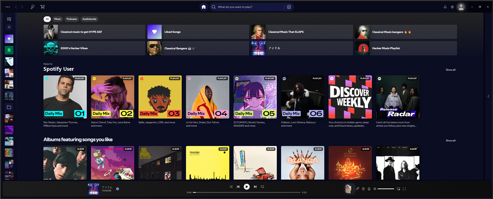

# Juxtaposed



Spotify that takes its colour from the song you're playing, with a roomier player bar and a tidier Home.

A [Spicetify](https://spicetify.app) theme.

## ✨ Features

### Colour

- The whole window is tinted with the dominant colour of the current cover, and fades between songs.
- The player bar and the glow at the top of Home carry the song's colour while it plays and go grey when you pause.
- Text stays white and surfaces stay dark whatever the cover looks like, so nothing becomes hard to read.

### Player bar

- Taller bar with a larger cover and title.
- On wide windows the song info and the right-hand buttons sit close to the playback controls instead of at the far edges.
- **Skip quiet intro**: when a track opens with four or more seconds of near-silence, a button appears to jump past it.

### Home and browsing

- Content uses the full width of wide windows (Spotify stops at 1955px).
- Type badges on cards: Playlist, Album, Podcast, Episode, Audiobook.
- **Hide** button on every Home section, shown when you hover it. Bring sections back with **Show hidden Home sections** in the profile menu.
- Search filters are squared, outlined tabs, so they read differently from the other pills.
- One readable title size on album, playlist and artist pages.
- Matching rounded corners on covers and shortcut tiles.

### Plays well with

- [Cat-Jam Synced](https://github.com/BlafKing/spicetify-cat-jam-synced): the cat gets a rounded tile beside the player buttons and a glow in the song's colour.
- [Stay Closed](https://github.com/superC12/spicetify-stay-closed): stops the Now Playing view from opening on its own.
- [Lyrics Plus (Juxtaposed Edition)](https://github.com/superC12/spicetify-lyrics-plus-juxtaposed): Lyrics Plus with a song-info panel, text size buttons and a small lyrics pop-up on the player bar. Its lyrics page takes a darkened version of the song's colour, so it matches the theme.

## 📦 Install

### Marketplace

Open the [Spicetify Marketplace](https://github.com/spicetify/marketplace), go to the **Themes** tab, search for **Juxtaposed** and click install.

> [!TIP]
> If Marketplace shows no tabs at all (this happens on Spotify 1.3.4 and 1.3.5 with Spicetify 2.45.3), you can't reach the Themes tab. Use the manual install below. Once the theme is running it brings the tabs back.

### Manual

1. Download this repo and copy `user.css`, `color.ini` and `theme.js` into a folder named `Juxtaposed` inside your Spicetify `Themes` folder.

   | Platform        | Path                                     |
   | --------------- | ---------------------------------------- |
   | **Windows**     | `%appdata%\spicetify\Themes\Juxtaposed\` |
   | **Linux/macOS** | `~/.config/spicetify/Themes/Juxtaposed/` |

2. Run:

   ```
   spicetify config current_theme Juxtaposed color_scheme Base inject_theme_js 1
   spicetify apply
   ```

## Updates (Windows)

Marketplace installs use Marketplace's **Installed → Update** action when an update is available. Custom apps can be discovered in Marketplace, but Lyrics Plus still needs the manual installation above.

For manual installs, download [update.ps1](update.ps1) and run it with PowerShell:

```powershell
# Update this project once
powershell -NoProfile -ExecutionPolicy Bypass -File .\update.ps1
# Enable a daily automatic update while signed in
powershell -NoProfile -ExecutionPolicy Bypass -File .\update.ps1 -EnableAutoUpdate
# Check without changing files
powershell -NoProfile -ExecutionPolicy Bypass -File .\update.ps1 -CheckOnly
# Stop automatic updates
powershell -NoProfile -ExecutionPolicy Bypass -File .\update.ps1 -DisableAutoUpdate
```

Use `-Component Both` on these commands to manage the theme and Lyrics Plus together. Only existing manual-install folders are updated. Updates come from the latest published GitHub release, skip an unchanged release commit, and run `spicetify apply` only after downloading changed files; this may reload Spotify. Backups are retained in a `juxtaposed-*` folder in Windows' temporary directory. Failed updates restore the original source files; errors are recorded in `%LOCALAPPDATA%\SpicetifyJuxtaposedUpdater\errors.log`. The scheduled updater runs as your current user without administrator privileges.

## ⚙️ Settings

Everything is in the profile menu (click your profile picture):

| Item                          | What it does                                                    |
| ----------------------------- | --------------------------------------------------------------- |
| **Dynamic Colors**            | Turns the song-based colours on or off                          |
| **Layout Tweaks**             | Turns the layout changes, badges and Hide buttons on or off     |
| **Show hidden Home sections** | Restores every Home section you have hidden                     |
| **Copy theme diagnostics**    | Copies a text summary of the page, useful when reporting a bug  |

## 🗑️ Uninstall

Remove it from the Marketplace **Installed** tab, or for a manual install run:

```
spicetify config current_theme " " color_scheme " "
spicetify apply
```

> [!NOTE]
> Tested on Spotify 1.3.4 and 1.3.5 with Spicetify 2.45.3 on Windows. Spotify renames its internal elements from time to time, so an update can break parts of the theme until it catches up. If something looks off, please [open an issue](https://github.com/superC12/spicetify-juxtaposed/issues) and paste the output of **Copy theme diagnostics**.

## 💡 Credits

Several ideas here come from Juxtopposed's video [I Redesigned the ENTIRE Spotify UI from Scratch](https://youtu.be/suhEIUapSJQ): the player bar that follows the song's colour, a homepage you can prune, and telling albums and playlists apart at a glance. This theme is a fan project. It is not made by or affiliated with Juxtopposed or Spotify.

## 📋 Changelog

Related changes are combined under the newest release version.

### v1.0.0

- Marketplace-compatible script URL and a Windows updater for manual installs, with optional daily updates and rollback on failure.

- Consolidated release for Spotify 1.3.4 and 1.3.5: song-based colours, roomier player bar, quiet-intro skipping, card badges and Home section hiding.
- Restores clickable Marketplace and Lyrics Plus tabs on Spotify 1.3.4 and later.

## License

[MIT](LICENSE)
